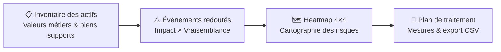

# RiskGuard — Analyse de risques cyber EBIOS Risk Manager

Outil web interactif qui digitalise la démarche EBIOS Risk Manager (ANSSI) :
inventaire des actifs, évaluation des risques, heatmap et plan de traitement exportable.

---

## Architecture



---

## Installation

```bash
git clone https://github.com/Bergson26/riskguard-ebios.git
cd riskguard-ebios
pip install -r requirements.txt
python -m streamlit run src/app.py
```

Interface disponible sur `http://localhost:8501`

---

## Fonctionnalités

- Inventaire dynamique des actifs (valeurs métiers, biens supports, niveau de sensibilité)
- Calcul du risque : Impact × Vraisemblance
- Heatmap 4×4 générée avec Plotly
- Moteur de règles : mesures de sécurité suggérées selon le niveau de risque
- Export CSV du plan de traitement complet
- Fonctionne entièrement en local — aucune donnée envoyée à l'extérieur

---

## Stack

- **Interface & logique** : Python 3, Streamlit
- **Données** : Pandas
- **Visualisation** : Plotly Graph Objects

---

## Résultats

- Cartographie complète d'un SI en moins de 30 minutes
- Plan de traitement exportable et intégrable dans un rapport d'audit
- Appliqué en contexte réel lors d'un audit (Logis Hôtel, 2026)

---

## Limites

- Pas de persistance des données entre les sessions (stockage en mémoire uniquement)
- Méthodologie simplifiée : ne couvre pas les ateliers 4 et 5 d'EBIOS RM complets
- Interface mono-utilisateur — pas de travail collaboratif
